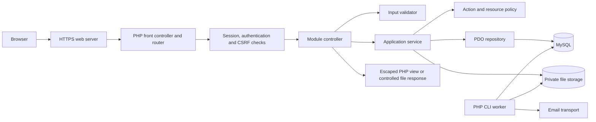

# Furoeducare Architecture

Draft for review · 16 November 2026

The [project requirements](PROJECT_REQUIREMENTS.md) define the business rules. This document proposes the initial technical design. Runtime versions, application structure and workflow design choices below are proposals for review.

## Stack and deployment baseline

| Layer | Proposed baseline |
| --- | --- |
| Application | Core PHP 8.5 with the latest stable patch in that branch. Use typed PHP, Composer autoloading and the PHP CLI for operational commands. [PHP supported versions](https://www.php.net/supported-versions.php) |
| Database | MySQL 8.4 LTS with a stable supported patch and the PDO MySQL driver. Use InnoDB, `utf8mb4`, foreign keys, and bound parameters for SQL values. [MySQL release tracks and distributions](https://dev.mysql.com/doc/refman/8.4/en/which-version.html) |
| Dependencies | A current stable Composer 2 release. Commit the dependency lockfile when dependencies are introduced and keep the package set small. [Composer releases and maintenance policy](https://getcomposer.org/download/) |
| Web interface | Server-rendered HTML5, CSS3, Bootstrap 5.3 and vanilla JavaScript. Share navigation, forms, errors and theme controls through PHP layouts and partials. [Bootstrap 5.3 color modes](https://getbootstrap.com/docs/5.3/customize/color-modes/) |
| Environments | Windows with local PHP and MySQL for development. Linux with a supported web server, PHP runtime and HTTPS for production. Use the same PHP and MySQL branches in development and production. Confirm the actual binaries and extensions at setup. |

Laravel, React, Next.js, Vue and a Node.js application backend are outside the technology stack.

## Request handling and project layout

Use a modular monolith with one deployable PHP application. In-process service calls keep related recruitment and approval changes within one MySQL transaction. CLI workers handle email and CV extraction when those features are built, which keeps slow work off the HTTP request path without introducing another application backend.

| Area | Responsibility |
| --- | --- |
| `public/` | HTTP entry point and public static assets. The web server exposes this directory as the document root. |
| `app/Modules/` | Feature controllers, validators, services, domain models, policies, repositories and feature views. Introduce directories as the features need them. |
| `app/Core/` | Shared request and response handling, routing, configuration, sessions, rendering and database connection support. |
| `config/` | Non-secret configuration and route wiring. Read secrets and environment-specific settings from environment variables. |
| `resources/views/` | Shared layouts and view components used across modules. |
| `database/` | Ordered migrations and seeders. |
| `bin/` and `tests/` | PHP CLI operations and automated verification. |
| Private storage path | Configurable path outside every web root and alias. Contains CVs, identity files and access-controlled library files. |

Controllers translate requests to validated inputs and select responses. Validators check shape and required fields. Application services coordinate use cases and transactions. Models represent domain state and rules. Policies determine whether an actor can perform an action on a specific resource. Repositories own SQL and data mapping. Views render prepared data using contextual escaping.

## Module boundaries and data ownership

The entities below are conceptual. The schema, endpoints and user interface will be designed in their implementation phases.

| Module | Owns |
| --- | --- |
| Accounts and access | Credentials, public account category, internal staff permissions and account lifecycle. |
| Schools | Institution identity, its single account association, and school approval history. |
| Teacher profiles and directory | Editable professional profile, professional verification, directory approval and an explicit public projection of approved fields. |
| Documents | Private file metadata, CV extraction jobs and drafts, and original CV access requests and grants. |
| Recruitment | Teacher and information requests, school vacancies, applications, shortlists and final placement. |
| Tutoring | Parent tutoring requests and their management workflow. |
| Messaging and notifications | Customer-to-staff conversations and event-driven email delivery. |
| Library | Book metadata, publication state and download access rules. |
| Training and workshops | School requests and management handling. |

Use stable internal identifiers and explicit foreign keys for ownership. For BR-09, resolve an institution to a canonical identity and enforce a unique account association in the database. Base uniqueness on the institution identity so registrations with different email addresses still use the same constraint. The business still needs to agree how schools are matched and how branches or ambiguous duplicates are handled.

Persist approval states with the actor, timestamp and relevant resource. Use service-level actions for state transitions and record consequential staff decisions in an audit trail. Apply indexes to owner and status lookups and paginate the directory and work queues. Store timestamps in UTC and format user-facing times as appropriate for Nigeria.

## Workflow and data boundaries

### Directory and recruitment

- Build the public directory from an explicit projection of approved professional fields for approved, publicly listed teachers. Use that same projection for search results and direct profile views. Keep private contact fields, original CV data, private file identifiers and unrestricted extraction text outside public responses.
- Professional verification, directory approval and school approval have independent persisted state. Enforce those states through policies and service actions on every relevant endpoint, including direct requests.
- Route customer teacher and information requests to management. Route tutoring requests to their submitting parent and authorised staff. Enforce school approval for vacancy posting on the server.
- Allow otherwise eligible applications before professional verification. When finalising placement, verify the teacher's current professional verification status within the same transaction as the placement write. Coordinate concurrent verification and placement updates on the same authoritative record. Shortlisting and placement actions require management permissions.

### CV extraction and access

1. Validate the upload against the configured type and size policy. Use server-side file checks, a generated storage identifier and private storage. Record the uploaded version and enqueue extraction from that version.
2. Process the document with a bounded PHP CLI job. Save structured suggestions as a draft. A failed or repeated job can update its own processing state and leaves the teacher's saved profile intact. The teacher reviews, edits and explicitly saves professional fields.
3. For disclosure to a requester, management reviews the access request and records its decision. Each original CV grant binds the requesting account to a specific CV version. The download policy checks the current grant and privacy conditions at delivery. Teachers receive no request to approve access.
4. Stream authorised files through a controlled download response. Use attachment delivery, private cache controls and opaque storage identifiers. Record access events with minimal metadata. Identity files have their own staff access policy.

Process file storage and database writes with explicit cleanup or recovery for failures between them. Treat uploaded documents and extracted text as untrusted input. Keep raw document contents out of logs and notification messages.

### Messaging, email and library

- Scope internal conversations to the originating customer account and authorised staff. The server checks membership and staff permissions when users read or add messages.
- For configured email events, persist a delivery record in the same transaction as the workflow update. A CLI worker retries transient delivery failures and tracks outcomes. Use a stable event or delivery identifier to prevent duplicate jobs and limit duplicate sends where the transport supports deduplication.
- Deliver published free books to visitors. Apply access policy at download time for managed library items. Knowing a library item identifier confers no download access.
- Payments have no active routes, checkout or processing in the initial release.

## Shared security and interface rules

- Use PHP password hashing and verification, regenerate session identifiers after login and privilege changes, and invalidate sessions on logout. Configure production cookies with `Secure`, `HttpOnly` and an appropriate `SameSite` policy.
- Require CSRF tokens for state-changing browser requests, including forms and signed-in uploads. Enforce authorisation at the server for each action and record, with permissions denied by default. Scope queries to the actor where appropriate.
- Validate input server-side. Bind SQL values using native PDO prepared statements and allowlist any dynamic SQL identifiers, such as sort fields. Escape HTML, attributes and other output for their specific contexts. Keep production error details and sensitive data out of client responses.
- Keep secrets in environment variables. Use separate runtime and migration database privileges and restrict filesystem access for the web and worker processes. Configure backups for MySQL and private storage and verify recovery of both.
- Use a shared layout with semantic landmarks, labelled forms, accessible feedback and visible keyboard focus. Use Bootstrap color variables and `data-bs-theme` for light and dark, with system default following `prefers-color-scheme`. Persist the selected mode in the browser and test public, member and staff layouts in all three modes. [Bootstrap color-mode implementation](https://getbootstrap.com/docs/5.3/customize/color-modes/)

## Database changes and verification

- Run versioned migrations from the CLI and record applied versions. Use seeders for reference data and synthetic development or test records. Keep customer data and production credentials out of seed files.
- Use transactions for multi-table business changes, such as placing a teacher or approving a CV grant with its audit record. Combine constraints and explicit concurrency handling with service validation. Account for MySQL DDL commit behaviour when planning schema changes.
- Unit-test validators, visibility rules, policies and state transitions. Run integration tests against MySQL for migrations, constraints, transactions and concurrent changes. Test the HTTP entry points as each module lands to cover anonymous access, direct requests to gated actions, cross-account access, CSRF and protected file delivery.
- Use the acceptance conditions in the requirements to build the later test plan. Include extraction failure and retries, email test delivery, and manual checks for keyboard access, responsive layout and the three themes.

## Deployment and decisions for review

On Windows, point a local site at `public/` and verify that the project root cannot also be served through a parent document root or alias. This matters when a project lives under an existing XAMPP `htdocs` directory. Confirm the database server reports MySQL before validating migrations.

On Linux, serve `public/` over HTTPS and redirect HTTP to HTTPS. Deploy application and dependencies together. Keep writable storage and logs outside the document root. Run migrations and any enabled worker commands from the CLI. Verify document-root isolation, private downloads and worker health in the deployment environment.

The initial design leaves the precise school identity rules, public field allowlist, professional verification criteria and CV access rules to management and privacy review. Parser and mail transport choices belong to their feature phases, once file inputs and delivery requirements are defined.

## Candidate requests and controlled disclosure

The Disclosure module connects candidate cases to the owner's vacancy or tutoring request. Tutoring submissions create a case in the same transaction. Staff claim cases and build shortlists from approved public listings or applicants on the linked vacancy. The published shortlist contains only references and public titles. Restricted scope requests and the resulting grants are separate records.

The policy checks an approved notice version and the recipient's acknowledgement. Staff must document the case-specific consent evidence and review the exact CV version or professional profile revision. The approval transaction locks the involved accounts and checks recipient eligibility, case ownership and the teacher's current privacy controls before writing the decision and grant. Download requests use authenticated PHP controllers and a CSRF-protected POST. Delivery rechecks scope, expiry, version and revocation, reads the private file and records the download before sending bytes. Profile disclosure uses a separate endpoint and an allowlisted snapshot.

The [disclosure policy](DISCLOSURE_POLICY.md) documents activation, independent evidence review, privacy controls and the manual handling of data-subject requests.

## Managed recruitment and placements

The Placement module follows a teacher and an eligible requester through school employment or private tutoring. Application, tutoring request, candidate request and placement statuses belong to their respective records. Placement starts from a school application under review or a shortlisted tutor on a request awaiting arrangements. Staff assign responsibility, record decisions and schedule discussions in WAT. Teachers see their own placement updates. The requesting account sees its own released placements from the placement shortlist stage, with the candidate reference and details intended for the participants.

The source row and placement are locked for changes. The final decision rechecks current teacher verification, including the accepted CV and professional checks, and validates the school or parent and source. Employment also checks vacancy publication and capacity. Home tutoring pins the administrator's checklist to the teacher's current professional verification revision, records an evidence reference and keeps the underlying identity and reference evidence out of participant views. The write updates the companion source status, placement history, audit log and relevant notifications in one transaction. Selection records a separate decision. Final confirmation is made through the managed placement workspace.

The initial foundation's setup and current capabilities are documented in the [README](../README.md). See [decisions](DECISIONS.md), [implementation progress](IMPLEMENTATION_PROGRESS.md) and the [test plan](TEST_PLAN.md) for this phase.

The [database foundation](DATABASE.md) implements account, role, token, audit and settings storage. The migration ledger and CLI are separate from HTTP bootstrap. PHP sessions use file-backed storage for the initial deployment.

The public website routes are GET pages rendered by the Site module. Shared partials supply navigation, cards, forms and the footer. Vanilla JavaScript handles mobile navigation, appearance preferences and browser-only form validation and feedback. Public resource pages use empty states until the relevant services publish live items. The HTTP health route remains a liveness check.

The [authentication module](AUTHENTICATION.md) uses the shared public layout, PDO and file-backed PHP sessions. Its routes handle account activation, password resets and role-specific dashboard access. The Site module continues to render the contact preview and informational pages.

The Teacher module uses the shared session guard and verification tokens. It creates a private, owner-scoped profile after email activation. Section updates preserve other saved sections. Qualifications and experience use related rows, replaced transactionally within each section. Completion derives from saved values and the presence of a CV. The public Site controller does not read onboarding tables.

The teacher document service validates PDF and DOCX for CVs and also accepts JPEG and PNG for supporting professional files. Storage is private and configurable through `TEACHER_DOCUMENT_DIR`. The database stores opaque keys with the file metadata. Downloads are attachments served through the owner route or the administrator review route. A new CV replaces the active record in one transaction. Removal immediately revokes access to the old record. If deleting the private file fails, the record stays marked for deletion and the next document upload or removal for the account retries it. CV uploads queue a document-scoped extraction job in the upload transaction. The PHP CLI worker reads the original from private storage, validates the structured JSON draft and makes it available to its owner for seven days. Confirming the edited draft adds profile records transactionally, preserves saved fields and clears the draft. Scheduled cleanup expires old drafts and interrupted jobs. Directory publication and managed CV sharing with third parties belong to later phases. [OWASP file upload guidance](https://cheatsheetseries.owasp.org/cheatsheets/File_Upload_Cheat_Sheet.html)

## Teacher dashboard

An authenticated teacher opens Overview at `/dashboard/teacher`. Dashboard tabs share a module layout with responsive navigation, the account menu, and the site theme. Existing profile-section URLs remain valid. Profile completion, professional verification and document states come from the current account’s profile. The controller derives the account ID from the session and validates all editable fields server-side. The Notifications tab shows verification events. Recruitment, placement, library and messaging show informational states until their backend modules are available.

Availability saves selected teaching or tutoring options inside the existing profile section. Temporarily unavailable is exclusive. A start date can coexist with active preferences. Existing schedule values are still readable and accepted on the earlier profile form endpoint.

## School onboarding and review

School signup uses the shared account, mail and session services. Email verification creates the School role and its onboarding profile in the same transaction. A database unique key protects normalized institution identity. School dashboard reads and writes derive the owner from the session. An approval policy guards recruitment routes before any workflow can execute.

Administrators record decisions against the current profile revision. Review history provides school-owned notifications and staff audit details. A suspension updates the shared authentication flag and session version in the same transaction as the decision. School profile, draft and review writes lock the user, then the school profile.

## Parent accounts and tutoring intake

Parent signup uses shared profile registration and creates a private adult profile during email activation. The parent dashboard and its mutations require a verified Parent role. Parent profile and request queries use the signed-in owner. Intake creates private drafts, and a separate submit action checks the reviewed draft version before recording submission. Public teacher and library browsing uses the existing public routes.

## Private tutoring requests

The Parent module owns tutoring requests, staff matching, shortlists, status history and in-app updates. General requests and selections carried through directory sign-in land in the same parent editor. Submitting a tutoring request creates a central candidate case. Staff list and detail queries exclude drafts. Parent request and recommendation queries scope records to the signed-in owner.

Staff search the public directory using the required live tutoring mode. Matching changes and status decisions lock the request and check its current version. Tutors shown to parents come from public, currently available listings attached to their shortlist. The placement workspace confirms arrangements after rechecking the shortlisted tutor, lesson mode and verification. It updates the tutoring request, its history and notifications in the placement transaction.

The staff finder keeps the default request subject on the server and carries only the cursor in default pagination links. Submitted request detail includes the adult account's existing contact data for authorised staff coordination.

## Administrator verification

The staff hub at `/dashboard/admin/verification` links to four queues. Its routes and the existing school review routes require an active Administrator role, and review forms require CSRF tokens. Staff document downloads reuse the private attachment service and write an audit event. Review history records the reviewer, checked items, notes and time. Teachers and schools can read their own decision notes through their dashboards.

Decision writes lock the user and profile in that order, compare the reviewed revision and atomically store the change, history, audit and notification event. Teacher edits and pending document decisions update the reviewed revision. The teacher and school suspension flows can each hold a claim on the shared sign-in suspension. Clearing one claim preserves any other active claim or independent account suspension.

`TeacherEligibility::canApply()` evaluates current role, active email-verified account and profile completion. The application service calls `TeacherEligibility::requireForPlacement()` inside the transaction that marks an application Successful. It locks the current account and profile, requires an accepted current CV, and checks the professional decision on that revision.

## Teaching vacancies

The Vacancy module serves the public job board, school workspace and staff moderation screens. Every mutation requires a CSRF token. School records are scoped to the signed-in owner. Review actions check the current role and vacancy revision inside a transaction. Staff record a reason for rejection. Schools can revise rejected, approved or published content and resubmit it. Material edits return the vacancy to draft and pause public access until staff publish the new revision.

The public query selects posting content, the application deadline and the institution name captured at publication. It checks the school's current approval and active account. Applications use the same availability rules under a vacancy lock. The application stores the published revision and a copy of the posting, including the advertised school name. Status updates use the locked application row and write history and audit records in the same transaction. Teachers and staff use separate entry points to read applications and history.

An application also stores an opaque candidate reference, an optional statement and an allowlist of professional fields from the locked teacher profile. It excludes account contact fields, references and document data or storage identifiers. The staff application page can link to the existing restricted verification screens. Neither the public vacancy nor the school workspace reads candidate records. Saved jobs use the same public vacancy eligibility query to decide when to show a public link.

Recruitment writes that span multiple accounts lock their user rows in ascending order before checking profiles. Directory requests lock their account and target user rows in the same order.

## Public teacher directory

The Directory module separates publication, public reads, and private interactions. Publication writes staff-reviewed fields and subject and level tags to a public listing record. The publication and withdrawal transactions update the teacher’s publication stamp, version the reviewed listing and record audit events. The editor verifies the authorisation for names and photographs independently. Photo uploads use PHP GD to decode and re-encode a bounded JPEG and discard upload metadata. GD is required for adding or replacing photographs.

Public SQL selects a fixed field list. It joins the private profile and account to check publication, sign-in status and current availability. It intersects the approved availability categories with the teacher’s current choices and evaluates start dates in Africa/Lagos. Profile, search, bookmark browsing and photo delivery apply the same visibility predicate. Filtered pages use the public reference as a cursor and load up to 12 results.

Authentication takes a typed public reference and constructs a fixed internal request URL. The same-browser continuation expires after 30 minutes. An email verification link can carry the public reference into a different browser. Bookmark and request writes recheck current eligibility and lock the requester and target account before writing. The request intake queue shows submitted records to active administrators.
