# Furoeducare Database Foundation

The schema runs on MySQL 8.4 LTS. Tables use InnoDB and default to `utf8mb4_0900_ai_ci`. The PDO connection uses `utf8mb4`, UTC, native prepared statements and exceptions. Application tables cover identity, roles, account tokens, audits, settings and private teacher onboarding.

## Entity relationship diagram

```mermaid
erDiagram
    USERS ||--o{ USER_ROLES : receives
    ROLES ||--o{ USER_ROLES : grants
    USERS ||--o{ PASSWORD_RESET_TOKENS : owns
    USERS ||--o{ EMAIL_VERIFICATION_TOKENS : owns
    USERS |o..o{ AUDIT_LOGS : acts_in
    USERS ||--o| SCHOOL_ONBOARDING : has
    USERS ||--o| PARENT_PROFILES : has
    PARENT_PROFILES ||--o{ PARENT_TUTORING_REQUESTS : owns
    USERS ||--o{ CANDIDATE_REQUESTS : submits
    VACANCIES |o--o{ CANDIDATE_REQUESTS : relates_to
    PARENT_TUTORING_REQUESTS |o--o| CANDIDATE_REQUESTS : relates_to
    CANDIDATE_REQUESTS ||--o{ CANDIDATE_SHORTLISTS : contains
    CANDIDATE_REQUESTS ||--o{ CANDIDATE_DISCLOSURE_REQUESTS : contains
    CANDIDATE_DISCLOSURE_REQUESTS ||--o| CANDIDATE_DISCLOSURE_GRANTS : authorises
    CANDIDATE_DISCLOSURE_GRANTS ||--o{ CANDIDATE_DISCLOSURE_DOWNLOADS : records
    USERS ||--o{ CANDIDATE_PRIVACY_REQUESTS : submits
    TEACHER_PROFILES ||--o| TEACHER_DISCLOSURE_PREFERENCES : controls
    PARENT_TUTORING_REQUESTS ||--o{ TUTORING_CANDIDATES : considers
    PARENT_TUTORING_REQUESTS ||--o{ TUTORING_REQUEST_HISTORY : records
    TEACHER_PROFILES ||--o{ TUTORING_CANDIDATES : shortlisted_for
    TEACHER_PROFILES |o--o{ PARENT_TUTORING_REQUESTS : confirms
    USERS |o..o{ TUTORING_REQUEST_HISTORY : acts_in
    SCHOOL_ONBOARDING ||--o{ SCHOOL_REVIEWS : receives
    USERS ||--o{ SCHOOL_REVIEWS : records
    SCHOOL_ONBOARDING ||--o{ SCHOOL_RECRUITMENT_DRAFTS : owns
    SCHOOL_ONBOARDING ||--o{ VACANCIES : owns
    VACANCIES ||--o{ VACANCY_HISTORY : records
    VACANCIES ||--o{ VACANCY_APPLICATIONS : receives
    TEACHER_PROFILES ||--o{ VACANCY_APPLICATIONS : submits
    USERS ||--o{ SAVED_JOBS : owns
    VACANCIES ||--o{ SAVED_JOBS : saved_by
    VACANCY_APPLICATIONS ||--o{ VACANCY_APPLICATION_HISTORY : records
    USERS |o..o{ VACANCY_HISTORY : acts_in
    USERS |o..o{ VACANCY_APPLICATION_HISTORY : acts_in
    USERS ||--o| TEACHER_PROFILES : has
    TEACHER_PROFILES ||--o{ TEACHER_QUALIFICATIONS : records
    TEACHER_PROFILES ||--o{ TEACHER_EXPERIENCES : records
    TEACHER_PROFILES ||--o{ TEACHER_DOCUMENTS : owns
    TEACHER_DOCUMENTS ||--o| TEACHER_CV_EXTRACTIONS : queues
    TEACHER_PROFILES ||--o{ TEACHER_VERIFICATION_REVIEWS : receives
    USERS ||--o{ TEACHER_VERIFICATION_REVIEWS : records
    TEACHER_PROFILES ||--o{ TEACHER_DOCUMENT_REVIEWS : receives
    TEACHER_DOCUMENTS |o--o| TEACHER_DOCUMENT_REVIEWS : references
    USERS ||--o{ TEACHER_DOCUMENT_REVIEWS : records
    USERS ||--o{ VERIFICATION_NOTIFICATIONS : receives
    TEACHER_PROFILES ||--o| TEACHER_LISTINGS : has
    TEACHER_LISTINGS ||--o{ TEACHER_LISTING_TAGS : categorises
    TEACHER_LISTINGS ||--o{ SAVED_TEACHERS : bookmarked_as
    USERS ||--o{ SAVED_TEACHERS : owns
    TEACHER_LISTINGS ||--o{ TEACHER_LISTING_REQUESTS : targeted_by
    USERS ||--o{ TEACHER_LISTING_REQUESTS : submits

    USERS {
        bigint id PK
        varchar email UK
        varchar password_hash
        datetime email_verified_at
        datetime suspended_at
        int auth_version
        datetime created_at
        datetime updated_at
    }
    ROLES {
        bigint id PK
        varchar slug UK
        varchar name
        datetime created_at
        datetime updated_at
    }
    USER_ROLES {
        bigint user_id PK, FK
        bigint role_id PK, FK
        datetime created_at
    }
    PASSWORD_RESET_TOKENS {
        binary token_hash PK
        bigint user_id FK
        datetime created_at
        datetime expires_at
        datetime consumed_at
    }
    EMAIL_VERIFICATION_TOKENS {
        binary token_hash PK
        bigint user_id FK
        varchar email_at_issue
        datetime created_at
        datetime expires_at
        datetime consumed_at
    }
    AUDIT_LOGS {
        bigint id PK
        bigint actor_user_id FK
        varchar action
        json context
        datetime created_at
    }
    SCHOOL_ONBOARDING {
        bigint user_id PK, FK
        varchar school_name
        varchar category
        char state_code
        varchar city
        varchar address
        varchar contact_email
        varchar contact_phone
        varchar representative_name
        varchar representative_position
        varchar institution_name_key
        varchar institution_city_key
        varchar terms_version
        varchar privacy_version
        datetime accepted_at
        enum review_status
        datetime school_suspension_at
        int revision
        datetime approved_at
        datetime created_at
        datetime updated_at
    }
    SCHOOL_REVIEWS {
        bigint id PK
        bigint school_id FK
        bigint reviewer_id FK
        enum decision
        json checks
        varchar reason
        datetime created_at
    }
    SCHOOL_RECRUITMENT_DRAFTS {
        bigint id PK
        bigint school_id FK
        varchar title
        varchar requirements
        datetime created_at
        datetime updated_at
    }
    PARENT_PROFILES {
        bigint user_id PK, FK
        varchar first_name
        varchar last_name
        varchar phone
        char state_code
        varchar city
        varchar terms_version
        varchar privacy_version
        datetime accepted_at
        datetime created_at
        datetime updated_at
    }
    PARENT_TUTORING_REQUESTS {
        bigint id PK
        bigint parent_id FK
        varchar subject
        varchar requirements
        datetime submitted_at
        datetime created_at
        datetime updated_at
    }
    TEACHER_PROFILES {
        bigint user_id PK, FK
        enum category
        varchar first_name
        varchar last_name
        varchar phone
        varchar terms_version
        varchar privacy_version
        datetime accepted_at
        datetime professional_verified_at
        enum verification_status
        bigint verification_revision
        datetime teacher_suspension_at
        datetime published_at
        json sections
        datetime created_at
        datetime updated_at
    }
    TEACHER_QUALIFICATIONS {
        bigint id PK
        bigint teacher_id FK
        varchar qualification
        varchar institution
        varchar field_of_study
        smallint completed_year
    }
    TEACHER_EXPERIENCES {
        bigint id PK
        bigint teacher_id FK
        varchar position_title
        varchar organisation
        smallint started_year
        smallint ended_year
        varchar description
    }
    TEACHER_DOCUMENTS {
        bigint id PK
        bigint teacher_id FK
        enum kind
        char storage_key UK
        varchar display_name
        varchar media_type
        int bytes
        datetime created_at
        datetime delete_requested_at
        bigint cv_teacher_id UK
    }
    TEACHER_CV_EXTRACTIONS {
        bigint document_id PK, FK
        enum status
        json draft
        varchar failure_code
        datetime started_at
        datetime expires_at
        datetime applied_at
        datetime created_at
        datetime updated_at
    }
    TEACHER_VERIFICATION_REVIEWS {
        bigint id PK
        bigint teacher_id FK
        bigint reviewer_id FK
        bigint revision
        enum decision
        json checks
        varchar reason
        datetime created_at
    }
    TEACHER_DOCUMENT_REVIEWS {
        bigint id PK
        bigint document_id FK, UK
        bigint teacher_id FK
        bigint reviewer_id FK
        enum kind
        enum decision
        varchar reason
        datetime created_at
    }
    VERIFICATION_NOTIFICATIONS {
        bigint id PK
        bigint user_id FK
        varchar event
        varchar title
        varchar message
        datetime created_at
    }
    TEACHER_LISTINGS {
        bigint id PK
        bigint teacher_id FK, UK
        char reference UK
        varchar title
        varchar bio
        varchar qualification
        tinyint experience
        char state_code
        varchar city
        tinyint availability_mask
        varchar professional_name
        blob photograph
        varchar approval_basis
        datetime approved_at
        int revision
    }
    TEACHER_LISTING_TAGS {
        bigint listing_id PK, FK
        enum kind PK
        varchar label PK
    }
    SAVED_TEACHERS {
        bigint user_id PK, FK
        bigint listing_id PK, FK
        datetime created_at
    }
    TEACHER_LISTING_REQUESTS {
        bigint id PK
        bigint requester_id FK
        bigint listing_id FK
        enum requester_role
        varchar notes
        datetime submitted_at
        datetime created_at
        datetime updated_at
    }
    AUTH_RATE_LIMITS {
        binary bucket PK
        smallint attempts
        datetime window_started_at
    }
    SYSTEM_SETTINGS {
        varchar setting_key PK
        json setting_value
        datetime created_at
        datetime updated_at
    }
    SCHEMA_MIGRATIONS {
        varchar version PK
        char checksum
        enum state
        datetime started_at
        datetime applied_at
    }
```



| Relationship | Cardinality and deletion rule |
| --- | --- |
| Users to roles through `user_roles` | A user can hold multiple roles, and a role can be assigned to multiple users. Each assignment requires one user and one role. Its composite primary key prevents duplicate grants. Deleting a user removes their assignments. An assigned role is protected by `RESTRICT`. |
| Users to password-reset tokens | A user can have zero or more tokens. Each token belongs to exactly one user and is removed if the user is deleted. |
| Users to email-verification tokens | A user can have zero or more tokens. Each token belongs to exactly one user and is removed if the user is deleted. `email_at_issue` captures the intended address for the later verification workflow. |
| Users to audit logs | An event can have one actor or no actor. One actor can have many events. `SET NULL` keeps the event if its actor is deleted. |
| Users to school onboarding | A user may have one school onboarding record. The foreign key deletes it with its user. A unique index matches normalized name, city and state for complete profiles. Current review status is independent from email verification. A null review status represents a legacy record and uses its existing approval timestamp. |
| School onboarding to reviews | Each school has zero or more decisions. Removing the school removes its review history. Reviewer accounts are protected by `RESTRICT` while they are referenced. |
| School onboarding to recruitment drafts | A school can own multiple private drafts. The foreign key removes the drafts with the school. |
| Users to parent profiles | Each verified parent can have one adult profile. The profile is removed when its user is deleted. |
| Parent profiles to tutoring requests | A parent owns any number of requests. Requests store structured lesson preferences, stage, the optional selected teacher reference and the confirmed teacher ID. Indexes support owner lists and staff queues. Requests are removed with the parent’s profile. |
| Tutoring requests to candidates and history | A request can have several staff-selected tutors and status events. Candidate rows refer to teacher profiles and retain the approved public reference. History records the actor, prior stage, new stage and parent-visible note. Deleting a request removes its candidate and history rows. |
| Candidate cases and sources | Each case identifies a requester and may identify a selected teacher and assigned administrator. A vacancy can have multiple cases. A tutoring request has at most one case. An imported school enquiry stays unlinked until its owner chooses an eligible vacancy. |
| Candidate cases, shortlists and disclosure requests | A case can have several shortlist entries and scope-specific disclosure requests for its candidates. A disclosure request has at most one grant. The grant records the recipient, teacher, approver, policy version, exact profile revision or CV ID, expiry and revocation. |
| Disclosure grants and downloads | Each successful original CV delivery records the grant, the recipient, the exact document ID and the timestamp. The ID is retained as audit evidence if the underlying CV is removed. |
| Teacher sharing preferences and privacy rights | A teacher can have one record controlling disclosure. An account can have several privacy requests, each with an optional processing administrator and a recorded response. |
| Users to teacher profiles | One verified teacher or NYSC account can have one private profile. `user_id` is its primary and foreign key. `professional_verified_at` and `published_at` default to null. Teacher forms cannot change either status. |
| Teacher profiles to qualifications and experience | Each profile owns zero or more entries of each kind. Deleting the profile cascades to these entries. |
| Teacher profiles to documents | Each profile owns zero or more document metadata records. Unique generated `cv_teacher_id` values allow one active CV per teacher. A pending-removal record protects the cleanup key and is excluded from profile and download lookups. Deletion is restricted while document metadata exists, so an account deletion cannot silently orphan uploaded files. |
| Teacher documents to CV extraction | Each CV document can have one job and one temporary JSON draft. Removing the current CV hides the draft. Deleting document metadata cascades to its extraction record. The worker processes jobs using status and document ID, and expires drafts and interrupted jobs separately. |
| Teacher profiles to professional reviews | One teacher can have multiple decisions and at most one decision on a revision. Deleting the profile removes these records. Reviewer accounts are protected by `RESTRICT` while referenced. |
| Teacher profiles and documents to document reviews | A profile may have many document reviews and a document may have one. Deleting the file record sets the foreign key to null and preserves the original ID, kind, decision and reviewer. Deleting the profile removes the review history. Reviewers are protected by `RESTRICT`. |
| Users to verification notifications | Each event has one account recipient. Deleting the recipient cascades to their event list. |
| Teacher profiles to public listings and tags | A teacher can have one stable listing. Its random reference supports public links and cursor pagination. Subjects and levels have an index on kind, label and listing. The listing has regional, qualification and experience indexes. Deleting a listing cascades to its tags. |
| Users and listings to saved teachers | Each user can save each listing once. Removing a user or a listing removes its bookmarks. |
| Users and listings to teacher requests | Each requester can keep one draft or submission per listing. A null submission time means it is a private draft. Requests are removed with the requester. Listings referenced by requests are protected by `RESTRICT` and can be withdrawn from public view. |
| School accounts to vacancies and vacancy history | Each vacancy has one owning school. Each recorded vacancy revision has one history event with the actor, status and note. Vacancy indexes cover owner, queue status and application deadline. |
| Vacancies and teacher profiles to applications | Each teacher can apply once per vacancy. An application records the teacher, vacancy revision and a copy of the posting. A separate history row records each application status change. Foreign keys protect vacancies, teachers and applications while they have dependent records. Audit actors can be cleared from history if an account is deleted. |
| Users and vacancies to saved jobs | Each teacher can bookmark each vacancy once. The bookmark retains the title shown when it was saved. Deleting the user or vacancy removes its bookmarks. |
| System settings, rate limits and migration ledger | These tables stand on their own. Settings hold non-secret application values. Rate limits store hashed bucket identifiers, window start times and attempt counts. The ledger tracks checked-in schema versions. |

The reference roles are `teacher`, `school`, `parent` and `admin`. The seeder assigns no role to an account. Application workflows will govern public registration categories and administrative grants.

## Schema conventions

- Entity IDs and matching foreign keys use `BIGINT UNSIGNED`. Constraints use `fk_<table>_<relationship>`, unique indexes use `uq_<table>_<key>`, and secondary indexes use `idx_<table>_<lookup>`. Specify each foreign key's deletion behavior. Primary identifiers are stable and use the default restrictive update behavior.
- Email uniqueness is case-insensitive and accent-sensitive. Role slugs and setting keys use case-sensitive ASCII collation. MySQL compares trailing spaces as padding for these identifiers. Token tables use the raw 32-byte digest as a unique primary key. Future token issuance stores only digests and checks expiry and consumption before accepting a presented token.
- Indexes cover membership lookups in both directions, tokens by user and expiry, global token expiry scans, and audit history by actor or time. The `created_at` and `updated_at` columns use `DATETIME(6)` in UTC. Mutable entities receive both timestamps. Assignments and audit events record creation, and tokens record creation, expiry and consumption.
- The foundation uses hard deletion with explicit foreign-key behavior. No current requirement calls for a soft-delete column. Account deletion rules, retention durations and token workflows belong to their respective phases. Audit context and settings must exclude passwords, raw tokens and other secrets.

## Local MySQL setup

Install a current MySQL 8.4 LTS patch. Keep it on a different port if XAMPP's MariaDB already uses port 3306. The examples use port 3307 and a database dedicated to this project. [MySQL Windows downloads](https://dev.mysql.com/downloads/mysql/8.4.html?os=3)

1. Connect to the development MySQL instance as its administrator. Confirm the server and create the dedicated development schema and user.

   ```sql
   SELECT VERSION(), @@hostname, @@port;
   CREATE DATABASE furoeducare_dev CHARACTER SET utf8mb4 COLLATE utf8mb4_0900_ai_ci;
   CREATE USER 'furoeducare_dev'@'127.0.0.1' IDENTIFIED BY RANDOM PASSWORD;
   GRANT SELECT, INSERT, UPDATE, DELETE, CREATE, ALTER, DROP, INDEX, REFERENCES
       ON furoeducare_dev.* TO 'furoeducare_dev'@'127.0.0.1';
   ```

2. From the project root, run `composer install`. Copy `.env.example` to `.env` if needed. Set `APP_ENV=development`, `DB_HOST=127.0.0.1`, `DB_PORT=3307`, `DB_DATABASE=furoeducare_dev` and `DB_USERNAME=furoeducare_dev`. In the ignored file, set `DB_PASSWORD="paste the generated password here"`. The quotes preserve punctuation in the generated password. Process environment settings take precedence.
3. Run the schema and seed commands.

   ```powershell
   php bin/database.php status
   php bin/database.php migrate
   php bin/database.php seed
   php bin/database.php status
   ```

   The first status shows all migrations pending on an empty schema. The final status shows them applied through `0052_create_candidate_privacy_requests`. In production, use a dedicated migration identity with schema privileges and a runtime identity with only the data privileges it needs.

## Migrations and transactions

- Stop application writers before upgrading through migrations 0035–0038. The old application code does not assign candidate references and predates the expanded status values. Run all four migrations before starting the new version.
- Stop parent request and directory enquiry writers before applying 0039–0043 so the tutoring import captures every existing record. Migration 0040 preserves the original timestamps. Migration 0041 copies parent directory enquiries into tutoring requests and leaves school enquiries in their existing workflow. The tutoring data backfill and import are irreversible.
- Stop application writers before applying 0044–0052. Migrations 0045 and 0046 import school enquiries and submitted tutoring requests into candidate cases. They create no grants. Revocation and download records refer to the granted document ID even when its private file is later removed. The two imports are irreversible.

- Add the next four-digit version under `database/migrations/`. Each PHP file returns one `up` DDL statement and a `down` statement when reversal is practical. Use `null` for an irreversible migration. Keep applied files immutable. The runner checks the file hashes and refuses modified, missing or out-of-order applied history.
- `php bin/database.php rollback` reverses the latest recorded migration. Reversing 0038 drops saved jobs. Reversing 0037 relaxes the candidate reference and status constraints. The application reference backfill in 0036 is irreversible so existing references and decision history are preserved. Take a backup before rolling back a database with data. Apply and roll back on an autocommit connection. MySQL commits DDL independently of surrounding DML transactions. [MySQL atomic DDL and implicit commits](https://dev.mysql.com/doc/refman/8.4/en/atomic-ddl.html)
- A database-specific MySQL advisory lock serialises schema commands and seeding. The runner writes `applying` or `rolling_back` before DDL and updates the ledger after success. If an operation is interrupted, use `status` and inspect the live table definitions before attempting recovery. For a disposable local schema, reset it using the steps below. For a database with valuable data, reconcile the actual schema with the migration and the verified backup before changing the ledger. [MySQL locking functions](https://dev.mysql.com/doc/refman/8.4/en/locking-functions.html)
- Seed files under `database/seeders/` return a closure that accepts the PDO connection and performs DML. The CLI seeds only when all migrations are current. Run seeders repeatedly to add missing reference values while preserving existing data. Use `Database::transaction($pdo, $operation)` for related DML changes. It commits on success and rolls back on exceptions. Pass the existing connection into related work inside the callback.

## Reset the local development schema safely

Use this procedure for the dedicated `furoeducare_dev` schema on the local loopback server. Creating a new development schema and updating `DB_DATABASE` preserves the old data if you want to keep it.

1. Stop the development application and any local workers. Run `php bin/database.php status` and verify the reported host, port and schema. Connect with `mysql --protocol=TCP --host=127.0.0.1 --port=3307 --user=root --password`. In the MySQL client, run `SELECT VERSION(), @@hostname, @@port, DATABASE();` and confirm you are on the intended local instance.
2. If the database contains any data you want to keep, back it up outside the project web root. Use a new backup filename and check the command exit code and file contents before continuing.

   ```powershell
   $backup = Join-Path $env:TEMP ("furoeducare_dev-" + (Get-Date -Format yyyyMMdd-HHmmss) + ".sql")
   if (Test-Path -LiteralPath $backup) { throw "Backup path already exists" }
   mysqldump --protocol=TCP --host=127.0.0.1 --port=3307 --user=root --password --single-transaction --set-gtid-purged=OFF --no-tablespaces --result-file="$backup" furoeducare_dev
   if ($LASTEXITCODE -ne 0) { throw "Database backup failed" }
   Get-Item -LiteralPath $backup
   ```

3. In the local MySQL administrator session, verify the selected target again.

   ```sql
   USE furoeducare_dev;
   SELECT DATABASE(), @@hostname, @@port;
   ```

   Read the result. Continue once it confirms the dedicated local `furoeducare_dev` schema and you have checked any needed backup.

   ```sql
   DROP DATABASE furoeducare_dev;
   CREATE DATABASE furoeducare_dev CHARACTER SET utf8mb4 COLLATE utf8mb4_0900_ai_ci;
   ```

4. Run `php bin/database.php migrate`, `php bin/database.php seed` and `php bin/database.php status`. Confirm no migrations remain pending and the four reference roles are present. To recover saved data, import the backup into a separate empty local schema first and verify it before updating any application configuration.

See the [test plan](TEST_PLAN.md) for running the isolated integration suite.
