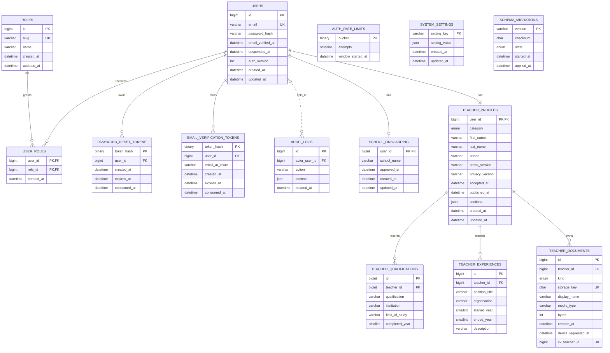

# Furoeducare Database Foundation

The schema runs on MySQL 8.4 LTS. Tables use InnoDB and default to `utf8mb4_0900_ai_ci`. The PDO connection uses `utf8mb4`, UTC, native prepared statements and exceptions. Application tables cover identity, roles, account tokens, audits, settings and private teacher onboarding.

## Entity relationship diagram



| Relationship | Cardinality and deletion rule |
| --- | --- |
| Users to roles through `user_roles` | A user can hold multiple roles, and a role can be assigned to multiple users. Each assignment requires one user and one role. Its composite primary key prevents duplicate grants. Deleting a user removes their assignments. An assigned role is protected by `RESTRICT`. |
| Users to password-reset tokens | A user can have zero or more tokens. Each token belongs to exactly one user and is removed if the user is deleted. |
| Users to email-verification tokens | A user can have zero or more tokens. Each token belongs to exactly one user and is removed if the user is deleted. `email_at_issue` captures the intended address for the later verification workflow. |
| Users to audit logs | An event can have one actor or no actor. One actor can have many events. `SET NULL` keeps the event if its actor is deleted. |
| Users to school onboarding | A user may have one school onboarding record. The foreign key deletes it with its user. A null approval timestamp means pending review. |
| Users to teacher profiles | One verified teacher or NYSC account can have one private profile. `user_id` is its primary and foreign key. `published_at` defaults to null, and onboarding does not set it. |
| Teacher profiles to qualifications and experience | Each profile owns zero or more entries of each kind. Deleting the profile cascades to these entries. |
| Teacher profiles to documents | Each profile owns zero or more document metadata records. Unique generated `cv_teacher_id` values allow one active CV per teacher. A pending-removal record protects the cleanup key and is excluded from profile and download lookups. Deletion is restricted while document metadata exists, so an account deletion cannot silently orphan uploaded files. |
| System settings, rate limits and migration ledger | These tables stand on their own. Settings hold non-secret application values. Rate limits store hashed bucket identifiers, window start times and attempt counts. The ledger tracks checked-in schema versions. |

The reference roles are `teacher`, `school`, `parent` and `admin`. The seeder assigns no role to an account. Application workflows will govern public registration categories and administrative grants.

## Schema conventions

- Entity IDs and matching foreign keys use `BIGINT UNSIGNED`. Constraints use `fk_<table>_<relationship>`, unique indexes use `uq_<table>_<key>`, and secondary indexes use `idx_<table>_<lookup>`. Specify each foreign key's deletion behavior. Primary identifiers are stable and use the default restrictive update behavior.
- Email uniqueness is case-insensitive and accent-sensitive. Role slugs and setting keys use case-sensitive ASCII collation. MySQL compares trailing spaces as padding for these identifiers. Token tables use the raw 32-byte digest as a unique primary key. Future token issuance stores only digests and checks expiry and consumption before accepting a presented token.
- Indexes cover membership lookups in both directions, tokens by user and expiry, global token expiry scans, and audit history by actor or time. The `created_at` and `updated_at` columns use `DATETIME(6)` in UTC. Mutable entities receive both timestamps. Assignments and audit events record creation, and tokens record creation, expiry and consumption.
- The foundation uses hard deletion with explicit foreign-key behavior. No current requirement calls for a soft-delete column. Account deletion rules, retention durations and token workflows belong to their respective phases. Audit context and settings must exclude passwords, raw tokens and other secrets.

## Local MySQL setup

Install a current MySQL 8.4 LTS patch. Keep it on a different port if XAMPP's MariaDB already uses port 3306. The examples use port 3307 and a database dedicated to this project. [MySQL Windows downloads](https://dev.mysql.com/downloads/mysql/8.4.html?os=3)

1. Connect to the development MySQL instance as its administrator. Confirm the server and create the dedicated development schema and user.

   ```sql
   SELECT VERSION(), @@hostname, @@port;
   CREATE DATABASE furoeducare_dev CHARACTER SET utf8mb4 COLLATE utf8mb4_0900_ai_ci;
   CREATE USER 'furoeducare_dev'@'127.0.0.1' IDENTIFIED BY RANDOM PASSWORD;
   GRANT SELECT, INSERT, UPDATE, DELETE, CREATE, ALTER, DROP, INDEX, REFERENCES
       ON furoeducare_dev.* TO 'furoeducare_dev'@'127.0.0.1';
   ```

2. From the project root, run `composer install`. Copy `.env.example` to `.env` if needed. Set `APP_ENV=development`, `DB_HOST=127.0.0.1`, `DB_PORT=3307`, `DB_DATABASE=furoeducare_dev` and `DB_USERNAME=furoeducare_dev`. In the ignored file, set `DB_PASSWORD="paste the generated password here"`. The quotes preserve punctuation in the generated password. Process environment settings take precedence.
3. Run the schema and seed commands.

   ```powershell
   php bin/database.php status
   php bin/database.php migrate
   php bin/database.php seed
   php bin/database.php status
   ```

   The first status shows ten pending migrations on an empty schema. The final status shows ten applied migrations. In production, use a dedicated migration identity with schema privileges and a runtime identity with only the data privileges it needs.

## Migrations and transactions

- Add the next four-digit version under `database/migrations/`. Each PHP file returns one `up` DDL statement and a `down` statement when reversal is practical. Use `null` for an irreversible migration. Keep applied files immutable. The runner checks the file hashes and refuses modified, missing or out-of-order applied history.
- `php bin/database.php rollback` reverses the latest recorded migration. Reversible table migrations drop their tables and rows. Authentication state, school onboarding, teacher profiles and teacher documents have irreversible migrations. These preserve security state, approval records, legal acknowledgements and file metadata. The full schema currently ends at `0014_create_teacher_documents`. Take a backup before rolling back a database with data. Apply and roll back on an autocommit connection. MySQL commits DDL independently of surrounding DML transactions. [MySQL atomic DDL and implicit commits](https://dev.mysql.com/doc/refman/8.4/en/atomic-ddl.html)
- A database-specific MySQL advisory lock serialises schema commands and seeding. The runner writes `applying` or `rolling_back` before DDL and updates the ledger after success. If an operation is interrupted, use `status` and inspect the live table definitions before attempting recovery. For a disposable local schema, reset it using the steps below. For a database with valuable data, reconcile the actual schema with the migration and the verified backup before changing the ledger. [MySQL locking functions](https://dev.mysql.com/doc/refman/8.4/en/locking-functions.html)
- Seed files under `database/seeders/` return a closure that accepts the PDO connection and performs DML. The CLI seeds only when all migrations are current. Run seeders repeatedly to add missing reference values while preserving existing data. Use `Database::transaction($pdo, $operation)` for related DML changes. It commits on success and rolls back on exceptions. Pass the existing connection into related work inside the callback.

## Reset the local development schema safely

Use this procedure for the dedicated `furoeducare_dev` schema on the local loopback server. Creating a new development schema and updating `DB_DATABASE` preserves the old data if you want to keep it.

1. Stop the development application and any local workers. Run `php bin/database.php status` and verify the reported host, port and schema. Connect with `mysql --protocol=TCP --host=127.0.0.1 --port=3307 --user=root --password`. In the MySQL client, run `SELECT VERSION(), @@hostname, @@port, DATABASE();` and confirm you are on the intended local instance.
2. If the database contains any data you want to keep, back it up outside the project web root. Use a new backup filename and check the command exit code and file contents before continuing.

   ```powershell
   $backup = Join-Path $env:TEMP ("furoeducare_dev-" + (Get-Date -Format yyyyMMdd-HHmmss) + ".sql")
   if (Test-Path -LiteralPath $backup) { throw "Backup path already exists" }
   mysqldump --protocol=TCP --host=127.0.0.1 --port=3307 --user=root --password --single-transaction --set-gtid-purged=OFF --no-tablespaces --result-file="$backup" furoeducare_dev
   if ($LASTEXITCODE -ne 0) { throw "Database backup failed" }
   Get-Item -LiteralPath $backup
   ```

3. In the local MySQL administrator session, verify the selected target again.

   ```sql
   USE furoeducare_dev;
   SELECT DATABASE(), @@hostname, @@port;
   ```

   Read the result. Continue once it confirms the dedicated local `furoeducare_dev` schema and you have checked any needed backup.

   ```sql
   DROP DATABASE furoeducare_dev;
   CREATE DATABASE furoeducare_dev CHARACTER SET utf8mb4 COLLATE utf8mb4_0900_ai_ci;
   ```

4. Run `php bin/database.php migrate`, `php bin/database.php seed` and `php bin/database.php status`. Check for ten applied migrations and the four reference roles. To recover saved data, import the backup into a separate empty local schema first and verify it before updating any application configuration.

See the [test plan](TEST_PLAN.md) for running the isolated integration suite.
