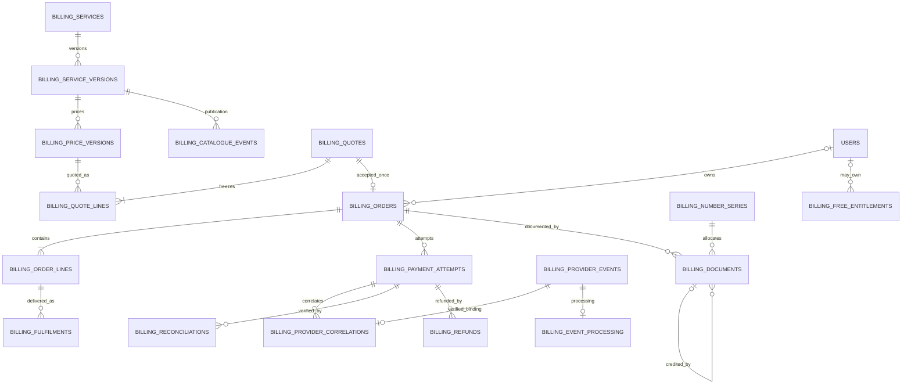

# Future monetisation readiness — design only

Status: proposed architecture for a separately approved future project, 23 November 2026. This document creates no schema, migrations, settings, interfaces, routes, checkout, invoices or provider integration. It does not authorise charging. The application remains modular Core PHP 8.5 with PDO, MySQL 8.4, Bootstrap and vanilla JavaScript.

## Current contract and boundaries

All currently offered services are free. Registration, recruitment workflows, applications, candidate requests, CV handling and authorised disclosure, library access under its existing policy, and training requests must continue without payment. Neither a billing record nor an order may become a prerequisite for these workflows. Existing account approval, professional verification, privacy, publication, ownership and distribution-rights rules still apply.

The library's existing database access value is `future_paid`; the product description “reserved_future_paid” means that same reserved category, not a new schema value. Its metadata may be visible when published, but its files remain unavailable to customers, with no checkout or purchase path. This does not mean an offered free service has acquired a fee. Staff's separately authorised review preview remains independent. `free` resources remain downloadable by guests; `restricted` resources require their existing explicit, revision-bound grants. See [library policy](DIGITAL_LIBRARY.md), [requirements BR-18](PROJECT_REQUIREMENTS.md), [decisions](DECISIONS.md) and [schema conventions](DATABASE.md).

This design reserves the concepts for future optional, separately described service offers. It does not permit turning on payments through the existing operational settings screen. Catalogue entries and zero-price examples below are specifications, not seed data or configuration to install. No live gateway, merchant account, automatic capture, payment credentials or provider SDK is selected here.

## Proposed service catalogue and pricing rules

Use stable service codes with immutable published versions. A version describes the service, eligible requester category, charge basis, what constitutes fulfilment, cancellation terms version and whether payment could ever gate this particular new optional offer. Editing a published version means creating a new version. A separate append-only publication/retirement event records when a version becomes available; published content is never rewritten.

| Proposed service family | Current behaviour to preserve | Future offer decision needed |
| --- | --- | --- |
| `account_registration` | Free; no order or billing dependency | Remains outside charging |
| `recruitment_request` / `placement_service` | Existing requests, applications, management and placements remain free | A distinct optional service and exact payer/delivery terms require approval; never silently charge an existing case |
| `cv_management` / `candidate_disclosure` | Upload, extraction, review and approved access remain free | Payment must never grant disclosure permission or override verification |
| `library_resource` | Free, restricted and unavailable reserved categories keep current semantics | Any new paid content offer requires rights review, a new explicit offer and separate approval |
| `training_programme` | Current module/package requests and management remain free | Any optional future paid programme needs scope, participant basis and explicit acceptance |

Prices use `currency CHAR(3) CHARACTER SET ascii COLLATE ascii_bin`, initially constrained to `NGN`, and nonnegative `BIGINT` integer minor units. NGN amounts are represented in kobo: a purely illustrative NGN 2,500.00 quote is `250000`; zero is `0`. Never use floating point or infer a currency from the browser. The currency exponent is snapshotted as `2`; adding another currency requires explicit review and versioned metadata. Bound quantities and amounts before arithmetic to prevent PHP/MySQL overflow.

Each price version records service version, price mode (`free` or `paid`), currency, unit amount, charge basis (`per_request`, `per_placement`, `per_participant`, `per_programme`, `per_resource_revision`), quantity bounds, effective start, optional exclusive effective end and applicable audience. `free` requires amount zero; an offered `paid` version requires a positive amount and approved activation. No recurring billing, saved payment methods, instalments or cross-currency orders are in scope.

UTC effective intervals are `[effective_from, effective_until)`. Select a price using authoritative server time and the service/audience/basis, then freeze it in a time-limited quote. Serialise publication on the stable service row and reject overlapping applicable price intervals inside the transaction; MySQL has no automatic exclusion constraint for time ranges. A new scheduled price version cannot alter an accepted quote or previous order. Quote expiry requires showing a replacement quote and obtaining fresh acceptance; never reprice silently. Catalogue publication, price publication and payment activation are separate decisions.

For a future paid offer, show the scope, quantity, integer-derived formatted unit price, line totals, approved tax treatment, total, cancellation/refund terms and expiry before acceptance. Tax details remain a review gate; this document neither selects rates nor asserts current legal requirements. A zero-value accepted offer creates no provider attempt and needs no card details. Existing free workflows continue directly and need no synthetic zero-value orders.

## Grandfathered free use and domain boundaries

At any approved future cutover, existing submitted requests, accepted programmes/arrangements, grants and completed downloads carry no retrospective debt. A request created under the free policy stays free throughout its existing lifecycle, including management review, scheduling, placement and completion, unless the owner separately chooses a clearly distinct new optional offer. Record the policy version and eligibility basis rather than reconstructing them later from a mutable price table.

Preserve an immutable cutover manifest of existing request IDs and their free-policy snapshot. Existing library grants remain governed by their original resource revision, expiry, revocation and publication rules; billing must not shorten them or demand payment. Download history stays history and is never converted into an order or receivable. A past download alone does not grant a new revision, bypass a restriction, extend an expired grant or override a rights withdrawal.

Any grandfathering of continued guest access must attach to the eligible published free resource revision/policy, not require identifying anonymous downloaders. Do not invent accounts or track visitors to implement it. A price change alone must not withdraw an existing free offer; paid content should be a distinct approved offer. Content edits and rights expiry retain their existing safety consequences. No billing design guarantees access after lawful rights withdrawal, publication removal or existing grant expiry.

Until formal activation of a specific new offer, abandoned checkouts, pending attempts, failed charges, provider outages and refunds cannot block any current service. After opt-in, only the separately accepted paid offer's future fulfilment may depend on reconciled payment. A payment cannot approve a school, verify a teacher, authorise a CV, publish content, secure placement or bypass library rights. Domain eligibility is rechecked at delivery even after payment; inability to deliver becomes a reviewed cancellation/refund case.

## Proposed MySQL records (not applied DDL)

The following is a field-level schema blueprint, not an instruction to create tables. All IDs and matching foreign keys are `BIGINT UNSIGNED`; immutable rows have `created_at DATETIME(6)` UTC. Mutable projections also have `updated_at DATETIME(6)` and an optimistic `revision INT UNSIGNED`. Text defaults to `utf8mb4_0900_ai_ci`; codes/references use case-sensitive ASCII. Use InnoDB, named `fk_`, `uq_` and `idx_` constraints, PDO prepared statements and transactions consistent with [DATABASE.md](DATABASE.md). Store only redacted, allowlisted JSON with bounded sizes.

| Proposed table | Principal columns and constraints |
| --- | --- |
| `billing_services` | `id`, unique `code VARCHAR(80)`, creation time. Stable identity only; retire through events, never reuse the code. |
| `billing_service_versions` | `id`, `service_id`, `version INT UNSIGNED`, title, bounded description, audience code, fulfilment definition, terms version, optional-offer/payment-gate eligibility. Unique `(service_id, version)`. Published rows immutable. |
| `billing_price_versions` | `id`, `service_version_id`, `version`, `price_mode`, `currency`, `currency_exponent`, `unit_amount_minor BIGINT UNSIGNED`, `charge_basis`, quantity bounds, `effective_from`, nullable `effective_until`, approved tax-rule/terms references. Unique `(service_version_id, version)`; checks on free/paid amount, valid interval, positive bounds; index service/effective time. |
| `billing_catalogue_events` | `id`, service/price version reference, event (`published`, `retired`, `activation_approved`, `activation_withdrawn`), effective time, nullable actor, approval evidence reference. Append only. Publication does not imply activation. |
| `billing_free_entitlements` | `id`, unique stable eligibility key, domain source kind/ID or resource ID/revision, nullable owner, policy version, original eligibility time, cutover manifest reference, reason (`existing_request`, `existing_grant`, `free_resource_revision`). Immutable proof; not a new library authorisation grant. |
| `billing_quotes` | `id`, unique opaque public reference, owner ID, currency/exponent, subtotal/tax/total minor units, immutable line/terms snapshot hash, expires time and creation time. Acceptance recorded in events with a unique quote-to-order binding. |
| `billing_quote_lines` | `id`, `quote_id`, ordinal, service version and price version IDs, domain source reference, quantity, unit/subtotal/tax/total amounts, immutable safe description and basis snapshot. Unique `(quote_id, ordinal)`; service/price pairing must match. |
| `billing_orders` | `id`, unique public reference, unique `quote_id`, owner ID, currency/exponent, frozen totals, terms version, acceptance time, current order state and revision. Unique `(owner_id, acceptance_key_hash BINARY(32))`; freeze payload hash for conflicting retries. Commercial order record, not the recruitment/training request. |
| `billing_order_lines` | `id`, `order_id`, unique line ordinal, quote line reference, immutable service/price/amount snapshots, domain source reference, accepted eligibility/policy snapshot. Preserve zero/free basis. Checks require arithmetic consistency within bounded limits. |
| `billing_fulfilments` | `id`, `order_line_id`, unique delivery key, domain source reference, quantity fulfilled, current fulfilment projection, evidence reference, revision. Multiple partial deliveries allowed within purchased quantity; history is in events. No automatic new access grant. |
| `billing_payment_attempts` | `id`, `order_id`, provider code/account alias, unique internal reference, scoped idempotency-key hash and request hash, expected amount/currency, nullable provider transaction reference, internal payment state, sanitised provider state and observation time, revision. Unique `(provider, account_alias, provider_transaction_reference)` when present; provider reference maps to one attempt only. |
| `billing_provider_events` | `id`, provider/account, unique event identity hash, transaction reference, raw-body digest, verified signature/key-version metadata, received time, safe allowlisted observation. Immutable verified inbox; no full raw webhook body stored here. Unique `(provider, account_alias, event_identity_hash)`; a changed digest on the same event ID is a conflict requiring review. |
| `billing_provider_correlations` | `id`, unique `provider_event_id`, `payment_attempt_id`, correlation evidence hash, nullable actor and creation time. Append only; a provider event may remain uncorrelated until its account/reference is verified. Incorrect correlation requires a review/exception event before any financial action; never silently rebind it. |
| `billing_event_processing` | `id`, unique `provider_event_id`, lease/attempt count, processing state, safe error code, next retry time and revision. Mutable processing projection separate from immutable evidence. |
| `billing_reconciliations` | `id`, payment attempt, nullable provider event, unique operation key, source (`server_query`, `settlement_review`), provider reference, observed amount/currency/result, observation time, safe evidence hash/reference, actor. Append only; corrective observations never rewrite old ones. |
| `billing_refunds` | `id`, payment attempt/order, unique internal reference, amount/currency, reason code, authoriser, requested time, current refund state/revision, scoped idempotency-key hash, request hash and nullable unique provider refund reference. Partial refunds supported; captured amount is the upper bound across pending/reserved and completed refunds. |
| `billing_documents` | `id`, order, kind (`invoice`, `credit_note`), unique `(series, number)`, unique immutable public reference, document/version IDs, issued time, currency, frozen lines/tax/totals and minimum required party snapshot, content hash, private artifact reference, nullable original invoice ID. Issued records immutable; drafts live outside this issued ledger. |
| `billing_number_series` | `id`, unique series code, next integer and revision. Lock row during issuance; never reuse issued numbers. Record any void allocation with reason. Series/tax/document requirements await approval. |
| `billing_events` | `id`, unique event key, aggregate kind/ID, event type, prior/new state codes, amount/currency if relevant, nullable actor ID, actor category, correlation ID, safe reason/evidence digest and timestamp. Append-only transaction audit, including acceptance, free entitlement, payment, reconciliation, fulfilment, refund, document and permission/activation decisions. |

All owned billing parents use restrictive deletion for financial children. Order, quote, version, payment, reconciliation, refund, issued document and source-evidence dependencies use `ON DELETE RESTRICT`; do not cascade a user deletion into the financial ledger. Nullable actor and account links may use `ON DELETE SET NULL` only with an approved privacy/retention policy and a non-identifying historical actor category. Account closure must use a reviewed anonymisation/retention process, not bypass these constraints. No retention duration is invented here.

Existing domain records need not gain billing foreign keys. A typed `(source_kind, source_id)` link must be validated through a bounded registry of permitted domain types and transactional ownership/eligibility checks; it is not an SQL foreign key and cannot validate itself. Snapshot minimal facts needed for accounting; retain a tombstone/evidence link where source retention removes personal data. Never store CV content, private tutoring details, rights evidence documents or message bodies in billing JSON. Every relation in the diagram means the proposed relationship; typed domain links require those application checks.



Provider events may arrive before an attempt is correlated; retain verified uncorrelated evidence and flag for review. Insert the separate immutable correlation record only after verifying the mapping. Never infer ownership from a webhook email. `billing_events` associates through a validated aggregate kind/ID registry rather than a polymorphic database foreign key. Add indexes for owner/time, order/state/time, attempt/provider reference, unprocessed events, reconciliation exceptions, refund/payment and document/order. Cross-row totals, aggregate quantity, price-interval overlap and refund caps require transaction locks; `CHECK` constraints alone cannot enforce them.

## Independent lifecycle states

| Axis | Proposed states | Meaning and transition guard |
| --- | --- | --- |
| Order | `accepted`, `cancel_requested`, `cancelled`, `closed` | Quote acceptance creates an order once. Cancellation is a commercial decision. Close only after delivery/cancellation and financial exceptions are resolved. It says nothing by itself about payment or recruitment approval. |
| Fulfilment | `not_started`, `in_progress`, `partially_fulfilled`, `fulfilled`, `cancelled`, `exception` | Follow domain evidence and delivered quantities. Refund does not rewrite an already delivered service as undelivered. A delivery failure remains visible. |
| Payment attempt | `created`, `pending`, `uncertain`, `succeeded`, `failed`, `cancelled`, `expired` | `succeeded` requires authenticated server-side reconciliation of exact amount, currency, merchant account and transaction binding. Timeout means uncertain, not failed. A browser redirect cannot settle payment. |
| Refund | `requested`, `approved`, `pending`, `uncertain`, `succeeded`, `failed`, `rejected` | Authorisation reserves refundable amount under lock. Provider confirmation/reconciliation settles it. Failure releases the reservation through an event; exact retries retain identity. |
| Provider observation | Provider-specific sanitized code plus mapped category and timestamp | Raw provider codes are evidence, not domain state. Unknown/out-of-order codes trigger reconciliation, not guessed success. Track disputes/chargebacks separately as financial exceptions. |
| Document | Issued immutable invoice or credit note; subsequent correction/void event | No editing issued totals, tax, parties, reference or document version. A credit note references the original invoice and approved adjustment. |

Financial summary is derived across attempts: expected, reconciled captured, refund-reserved, reconciled refunded and net. A successful attempt remains evidence of capture after a refund; it is not changed to `failed`. Prevent concurrent attempts from fulfilling twice, and detect excess/duplicate captures as exceptions for review/refund. A late verified capture following order cancellation must be reconciled and handled as a refund case; it does not resurrect the order or deliver a service. A later failed webhook cannot downgrade a reconciled capture. Payment/refund corrections require new reconciliation and audit evidence.

Only a future activated, explicitly accepted paid order line may require sufficient reconciled funds before delivery. Recheck the specific line's policy, paid coverage and current domain authorisation inside one locked transaction, append fulfilment/audit events and enqueue any notification with the same transaction. Exactly-once external delivery is not promised: use stable delivery keys and idempotent domain operations. Existing free service paths do not call a provider or depend on the billing subsystem being available.

## Provider boundary blueprint (documentation pseudocode only)

The future application layer should depend on a narrow provider contract, not on provider field names in controllers. This is a design sketch for later implementation; no corresponding PHP interface, adapter, route or stub is added.

```text
// Pseudo-PHP signatures; value types, storage and implementations are future work.
PaymentProviderContract:
    beginHostedPayment(ImmutablePaymentCommand, IdempotencyKey): InitiationObservation
    queryPayment(MerchantReference): PaymentObservation
    verifyAndDecodeWebhook(RawBytes, BoundedHeaders, VerificationContext): VerifiedEvent
    requestRefund(ImmutableRefundCommand, IdempotencyKey): RefundObservation
    queryRefund(RefundReference): RefundObservation
```

`ImmutablePaymentCommand` contains internal order/attempt references, integer amount/currency, approved hosted return/cancel destinations and only required payer contact. `InitiationObservation` contains provider reference, allowlisted hosted URL, normalized pending/uncertain state and expiry. `PaymentObservation`/`RefundObservation` contain merchant identity, references, amount/currency, bounded provider result, observed time and safe evidence digest. `VerifiedEvent` carries authenticated event identity, exact body digest, account identity, occurred time and allowlisted financial fields. Domain services own all transitions and authorization; adapters cannot mark fulfilment, issue CV grants or mutate source requests.

Use hosted payment pages in any approved future integration. Never receive or store PAN/card numbers, CVV, PIN, card expiry, bank credentials, raw authorisation tokens or provider secrets in application billing tables, logs, audit events, documents, URLs or analytics. Credentials and webhook verification material belong in separately managed private environment/secret configuration with rotation and least privilege. Provider URLs must be HTTPS and validated against reviewed host/path allowlists; internal callbacks come from fixed server configuration, not a user-supplied URL. Do not log a hosted URL containing bearer-like tokens.

Network calls run outside database transactions. First reserve the immutable intent/idempotency identity and append an event transactionally; then call the provider; then store a safe observation and reconcile under locks. Use the same key for an exact retry, reject changed payloads for that key, and never create a new charge solely because a response timed out. Retry/query rules depend on the selected provider's reviewed idempotency guarantees. No such guarantees are assumed in this document.

## Future webhook and reconciliation protocol

1. Bound request/body/header sizes, use TLS, verify the selected provider's signature over exact raw bytes before trusting fields, and validate the configured merchant/account and event type. Apply timestamp/replay checks where the provider protocol supports them. IP allowlists alone are insufficient. Read secret/key versions privately; never persist signatures or secrets in general logs.
2. Persist only verified, allowlisted event evidence using the scoped unique event identity. If a provider lacks a trustworthy event ID, define and review a deterministic identity from immutable signed fields for that provider. Concurrent exact duplicates acknowledge the same persisted event; changed payload digest under the same ID is quarantined. Invalid signatures produce bounded safe security telemetry and no financial state changes.
3. Acknowledge only after durable inbox commit. A worker claims the processing projection with a lease, maps known references and queries the provider's authenticated server API when necessary. An uncorrelated event stays queued for review; it never creates an order or payer from untrusted fields.
4. Verify account, transaction ownership, currency and exact captured amount against the frozen attempt. Record reconciliation evidence and append the state event transactionally with processing completion. Wrong/partial amounts, unknown status, stale observations, duplicate captures and disagreement between sources remain exceptions. A client redirect or screenshot is not evidence of capture.
5. Dispatch any eligible paid delivery through an idempotent, separately authorised domain operation after reconciliation; free entitlements bypass billing. Worker crashes before/after commit and webhook redelivery must not duplicate grants, invoices, delivery or notices. Recheck all domain rights at execution time.
6. Run an approved reconciliation job for uncertain/pending/late events and compare captured/refunded transactions with provider settlement reports. Record variances, accountable review and resolution events. Provider outage preserves uncertainty; do not declare payment failure or create another charge without evidence. Settlement differences, disputes and chargebacks require reviewed financial follow-up without automatically withdrawing unrelated free services.

## Documents, audit and administrative control

Billing records form a transaction subledger, not a claim that a complete general ledger or legally sufficient invoicing system exists. Before issuance, approve the invoice/receipt trigger, issuer identity, numbering series, required fields, tax treatment, retention and export rules. Never manufacture invoices for historical free requests or charge a historical free download. An optional free record must be clearly zero-value and cannot imply debt.

Use stable human-readable invoice references allocated under a series lock, alongside opaque public references. Freeze the issued document's template/version, language, parties, line descriptions, integer totals, currency, tax decision version and content hash. Later catalogue, address or template edits do not rewrite it. Corrections produce a new versioned adjustment document/credit note linked to the original; credit-note creation and refund completion are separate events, with independent reconciliation. Private rendered documents require owner/staff authorization and must not be publicly guessable URLs. A replacement rendering of the same issued content retains its content/version identity; changing content requires an adjustment, not overwriting the artifact.

Make `billing_events`, verified provider evidence, reconciliation evidence and issued documents append only to the runtime identity: no ordinary update/delete privileges on those ledgers. Record safe actor category, purpose, affected immutable version/reference, old/new state, operation/idempotency identity, correlation and UTC time. Append compensating events for mistakes. Restrict projections to necessary update privileges. Operational DBA access and backup restoration mean append-only is a controlled policy, not a claim of absolute tamper-proof storage; review privileged access, backups and integrity checks separately.

Proposed capabilities are `billing.read_own`, `billing.read`, `billing.reconcile`, `billing.refund.request`, `billing.refund.approve`, `billing.documents.issue`, `billing.catalogue.manage`, `billing.pricing.approve` and `billing.activation.approve`. They are design names only and are not added to the permission system. No current staff role or coarse `admin` marker implicitly acquires them. Separate preparer/approver for price publication, activation and refunds; deny self-approval. Use narrowly scoped delegated powers, current-permission checks in the transaction, fresh reauthentication for sensitive changes, CSRF, explicit confirmation, owner checks and audited reasons. Finance permissions confer no private CV/message/rights-document permissions. Staff cannot see secrets. Exports and invoice party information require separately bounded access and review.

Financial retention, payer data minimisation, access/deletion handling, dispute preservation, backup deletion and third-party disclosure must be documented and approved before collecting payment data. Do not copy existing sensitive account/domain data merely because it is available. Redact customer-facing notifications and staff logs; use authenticated links. This is an engineering review requirement, not legal, privacy or tax advice and makes no assertion about current law.

## Release, migration and rollback gates

1. Obtain formal, recorded management approval for the exact new optional service, payer, amount/basis, effective time, free grandfathering, delivery and cancellation/refund terms. Registration and existing recruitment/CV/library workflows remain free. Provider selection and paid content rights are separate decisions.
2. Complete legal/privacy/tax and accounting review with appropriate advisers; approve disclosures, documents, retention, provider data processing and operational responsibilities. Resolve open requirements explicitly, rather than treating this design as compliance evidence.
3. Review a concrete implementation and threat model, least-privilege permissions, webhook verification, provider account/secret handling, incident response, reconciliation/refund operations and customer support. Use provider sandbox credentials only during development. No production credentials or network payment calls are authorised by this document.
4. Propose new migrations without altering applied history. Test backup/restore and additive schema upgrade in isolated MySQL 8.4. Snapshot and reconcile free eligibility using a bounded cutoff, writer coordination and restartable idempotent batches. Compare counts/checksums before and after; anonymous download owners stay null. Preserve existing source IDs, grants, revisions and historical records; create no historical charges, invoices or outgoing payment notifications.
5. Run the future checks below and obtain documented release sign-off. Deploy reviewed dormant code first with charging disabled outside ordinary editable settings. Revalidate free paths. Any later activation requires an explicit service/version/audience/effective-date approval, and customer acceptance of a new offer; a global switch alone is insufficient.
6. Begin with an approved limited rollout and monitored reconciliation. Keep the free service path independent. Stop new paid acceptance/attempts on incidents without blocking existing free requests or destroying billing evidence. Continue authorised webhook ingestion, reconciliation and refund operations for in-flight transactions using the compatible worker version.

Rollback disables new paid offer acceptance first and preserves all free entitlements. Do not drop populated billing tables, reverse successful captures, delete issued documents or erase evidence. A safe application rollback must retain a compatible reconciliation/refund worker and ledger reader until in-flight liabilities are resolved. Honour already accepted scope or obtain a reviewed cancellation/refund outcome; never fall back to making a grandfathered request payable. MySQL DDL has independent commit behaviour, so approved migration/restore procedures and data reconciliation are required rather than assuming transactional DDL rollback. Restore backups into an isolated schema and reconcile provider-side changes before resuming writes.

## Planned acceptance evidence for a future release

These are future tests and review proofs, not tests run or capabilities implemented by this documentation change.

- Verify registration, every current recruitment and CV/disclosure step, library free downloads (including guests), existing restricted grants, and training requests complete without checkout, order, invoice, billing availability or provider calls. Pending schools retain current library access. Reserved `future_paid` customer downloads and checkout remain unavailable before separately approved scope.
- Test effective-time boundaries, interval-overlap publication races, zero-price validation, integer overflow, quantity limits, currency mismatch, quote expiry and immutable published price/quote/document snapshots. Price edits must not change accepted or grandfathered requests.
- Demonstrate exact acceptance retries yield one order, changed payloads conflict, and concurrent attempts cannot produce duplicate fulfilment. Simulate timeout before/after provider acceptance; an uncertain attempt queries/reconciles without blindly charging again.
- Verify forged, stale, replayed, duplicated, reordered and changed-digest webhooks; wrong account, wrong amount/currency, unknown reference and unknown status. Only authenticated exact reconciliation can release the particular paid offer. Browser redirects cannot do so.
- Exercise worker crashes around inbox/transition/outbox commits, late capture after cancellation, overpayment, partial delivery, failed delivery, provider outage, dispute, partial refunds, concurrent refund caps and credit-note/refund disagreement. Preserve independent state evidence and free-service access throughout.
- Attempt cross-account order/invoice access, privilege escalation, self-approval, stale-role writes, CSRF and access to CVs through billing permissions. Inspect rendered documents/logs/exports for PAN, secrets, raw webhook data and unrelated personal fields.
- Prove cutover manifests are restartable and contain all qualifying existing requests/grants without altering library permissions or counting anonymous users. Demonstrate unchanged download history and rights withdrawal, revision and expiry behaviour.
- Rehearse additive migration, backup restore, application rollback with in-flight payments, disabled new acceptance and continued reconciliation/refunds. Preserve free eligibility and every financial event/document. Record the approved evidence and unresolved limitations before any production activation.
